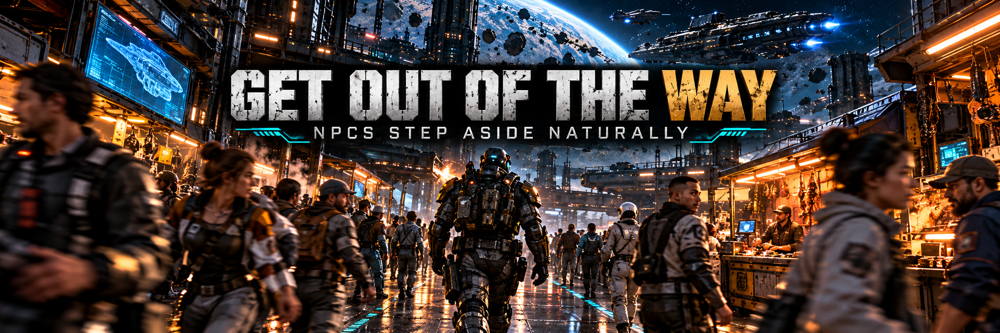

# Get Out of the Way — NPCs step aside naturally in SpaceBourne 2

In SpaceBourne 2's stations, markets and corridors, people stand in your way: you stop, or you
shove them aside with your body. With Get Out of the Way, calm NPCs notice you walking at them,
turn, take a short step out of your path, and step back to their spot once you have passed.

Version 0.1.0 · UE4SS Lua mod · works alone or with the rest of the
[realism set](#part-of-the-spacebourne-2-realism-set).

## What it does

- **Who steps aside:** civilians, guards at rest, allied crew and companions, your ground squad,
  and the traders, quest givers and crew you talk to.
- **Who never does:** enemies, creatures, bosses, anyone in a fight or alerted, anyone talking to
  you, sitting, playing a scripted animation or already walking somewhere.
- **Natural:** the NPC walks its step with its own walk animation and turns the way it goes. It
  steps to the side it is already on, a little away from you, 0.5 to 0.8 m, just enough to clear your
  path. It never steps into a wall or into another NPC: if one side is blocked it takes the other,
  and if both are blocked it stays.
- **Back to its spot:** once you have passed, it walks back and ends where it stood, facing the
  same way.
- **Human timing:** it reacts within 0.2–0.4 s when you are about 2 m away (further when you run),
  and also when you are already pressed against it and keep pushing.
  Someone with their back to you notices later, and doesn't notice at all if you sneak up crouched.
- **Calm, not twitchy:** at most 4 NPCs move at once, and the same NPC waits 3 s before it steps
  again.
- **Out of the way of the fights:** nothing happens while you are in a ship or on the hoverbike, or
  while Silent Ops reports an alert of Yellow or higher near you.
- **On by default.** No key needed.

## Requirements

- SpaceBourne 2 (Steam).
- [UE4SS 3.0.1](https://github.com/UE4SS-RE/RE-UE4SS/releases/tag/v3.0.1). Installing HTR or the
  realism set installer installs it too.

## Install

1. Download `GetOutOfTheWay-0.1.0.zip` from the
   [releases](https://github.com/hubertdungen/SpaceBourne2-GetOutOfTheWay/releases).
2. Extract it into the game folder (`...\steamapps\common\SpaceBourne 2\`). It adds
   `SB2\Binaries\Win64\Mods\GetOutOfTheWay\`; the `enabled.txt` inside turns it on.
3. That's it: walk into a station or a market.

Manual install: copy the `GetOutOfTheWay` folder from this repository into
`SpaceBourne 2\SB2\Binaries\Win64\Mods\`.

Uninstall: delete `SB2\Binaries\Win64\Mods\GetOutOfTheWay`. Get Out of the Way never writes to your
saves.

## Settings

Edit `Mods\GetOutOfTheWay\scripts\config.lua`, then restart the game. Every line is optional.

- `Enabled`: `false` switches the mod off completely.
- `TriggerDistance` (2.2 m): how far ahead an NPC on your path reacts (more when you run).
- `StepDistance` (0.8 m): the longest side step (0.5–1.0).
- `PathWidth` (0.75 m): how close to your line counts as "in your way".
- `ReturnToSpot`: step back to the old spot once you have passed (`true`).
- `Cooldown` (3 s): before the same NPC steps aside again.
- Who: `Civilians`, `Guards`, `Allies`, `Squad`, `Talkers` (`true` / `false`).
- `ToggleKey`: none by default. Set one, e.g. `"Shift+F3"` (the realism set's spare key), to switch
  the mod on and off in game. The game's own keys and the other set mods' keys are refused.

## How it works

The game creates its NPCs; the mod notes the calm kinds as they appear (no searching through the
world). A few times a second it looks only at the NPCs within 8 m of you: if one is ahead of you and
close to your line, its own AI is told to walk to a free spot beside it, checked on the game's
navigation mesh first. Details: [DESIGN.md](DESIGN.md).

## Status and known limits

<!-- nexus:skip -->
Tested in game on 2026-10-31 (details in [DESIGN.md](DESIGN.md), section 7), with HTR, Silent Ops,
Split Controls and Gear Without Levels installed:
- your squad and a civilian step aside when you walk or run at them, and when you are pressed
  against them; the civilian walks back to its spot;
- NPCs in a fight and crouched NPCs never move; nothing happens while Silent Ops reports Yellow;
- frame times with the mod on vs off: no difference (95 vs 95 fps, same median and p99);
- your saves untouched.
<!-- /nexus:skip -->

Known limits:

- **Animated decor stays put.** Many station extras (people sitting at the bar, vendors behind a
  counter, sweepers) are animations placed in the level, not characters: they cannot walk.
- **NPCs already walking keep their route.** Their own AI would cancel a step at once; they go
  around you the game's way.
- **City crowds on planets** use their own simple mover and are not affected.
- **If you stop on its spot**, the NPC waits a while and then stays where it is.

## Part of the SpaceBourne 2 realism set

Part of the realism set, built around [Hardcore Tactical Realism](https://www.nexusmods.com/spacebourne2/mods/4)
as the core mod. HTR is not required: this mod works on its own or with any of the others.
To install them all at once, use the installer:
[SpaceBourne 2 Realism](https://github.com/hubertdungen/SpaceBourne2-Realism)
([Nexus](https://www.nexusmods.com/spacebourne2/mods/11)).

| Mod | Status |
|---|---|
| **Hardcore Tactical Realism (HTR)** — realistic ballistics and tactical AI | released: [GitHub](https://github.com/hubertdungen/SpaceBourne2-HardcoreTacticalRealism) · [Nexus Mods](https://www.nexusmods.com/spacebourne2/mods/4) · [Steam discussion](https://steamcommunity.com/app/1646850/discussions/0/573805072991123580) |
| **Split Controls** — separate invert for ship and on foot | released: [GitHub](https://github.com/hubertdungen/SpaceBourne2-SplitControls) · [Nexus Mods](https://www.nexusmods.com/spacebourne2/mods/5) |
| **Silent Ops** — realistic stealth | released: [GitHub](https://github.com/hubertdungen/SpaceBourne2-SilentOps) · [Nexus Mods](https://www.nexusmods.com/spacebourne2/mods/6) |
| **Gear Without Levels** — use gear regardless of level | released: [GitHub](https://github.com/hubertdungen/SpaceBourne2-GearWithoutLevels) · [Nexus Mods](https://www.nexusmods.com/spacebourne2/mods/7) |
| **SB2 HOTAS** — HOTAS, triple screens, head tracking | released: [GitHub](https://github.com/hubertdungen/SpaceBourne2-HOTAS) · [Nexus Mods](https://www.nexusmods.com/spacebourne2/mods/8) |
| **Faction Power** — your deeds earn your faction power | released: [GitHub](https://github.com/hubertdungen/SpaceBourne2-FactionPower) · [Nexus Mods](https://www.nexusmods.com/spacebourne2/mods/9) |
| **Tactical Engineering** — realistic deployable turrets | released: [GitHub](https://github.com/hubertdungen/SpaceBourne2-TacticalEngineering) · [Nexus Mods](https://www.nexusmods.com/spacebourne2/mods/10) |
| **Ammo Discipline** — realistic ammo limits and scavenging | released: [GitHub](https://github.com/hubertdungen/SpaceBourne2-AmmoDiscipline) · [Nexus Mods](https://www.nexusmods.com/spacebourne2/mods/12) |
| **Ground Waypoints** — planet markers on foot and on the hoverbike | released: [GitHub](https://github.com/hubertdungen/SpaceBourne2-GroundWaypoints) · [Nexus Mods](https://www.nexusmods.com/spacebourne2/mods/13) |
| **Get Out of the Way** — NPCs step aside naturally (this mod) | released: [GitHub](https://github.com/hubertdungen/SpaceBourne2-GetOutOfTheWay) |
| Tactical First Person | coming |

## License

MIT. See [LICENSE](LICENSE).
